<p align="center">
  <a href="https://revuelto-3d.vercel.app">
    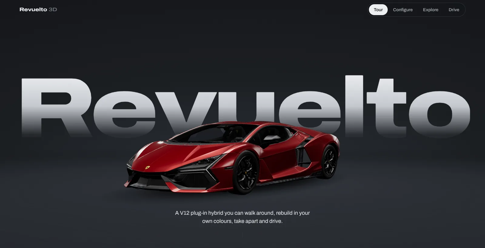
  </a>
</p>

<h1 align="center">Revuelto 3D</h1>

<p align="center">
  An interactive 3D showcase of the Lamborghini Revuelto that runs in the browser.<br>
  Scroll around it, build your own spec, look inside it, then drive it.
</p>

<p align="center">
  <a href="https://revuelto-3d.vercel.app"></a>
</p>

<p align="center">
  
  
  
  
  
</p>

<p align="center">
  <a href="#four-ways-to-see-the-car">Features</a> &nbsp;&middot;&nbsp;
  <a href="#controls">Controls</a> &nbsp;&middot;&nbsp;
  <a href="#run-it-locally">Run locally</a> &nbsp;&middot;&nbsp;
  <a href="#how-it-works">How it works</a> &nbsp;&middot;&nbsp;
  <a href="#make-it-your-own">Customise</a>
</p>

<br>

## Four ways to see the car

The switcher at the top of the page moves between four views. They all share one car, so a colour you pick in **Configure** is the car you take into **Drive**. Configure and Explore take place in an isometric workshop where a mechanic is busy at the back of the car.

<table>
  <tr>
    <td width="50%" valign="top">
      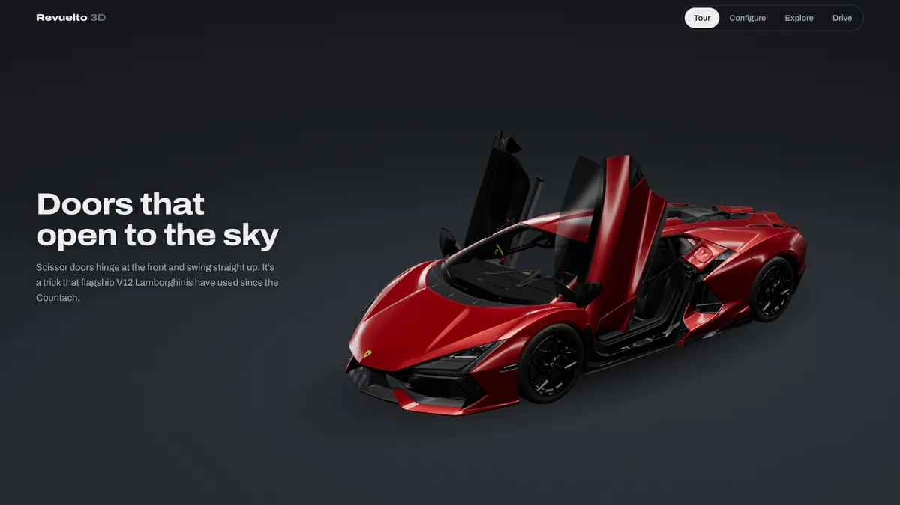
      <h3>Tour</h3>
      <p>Eight chapters that play as you scroll. The camera moves around the car, and the doors, engine cover and lights open as the story reaches them. It ends with the key figures and a choice of where to go next.</p>
    </td>
    <td width="50%" valign="top">
      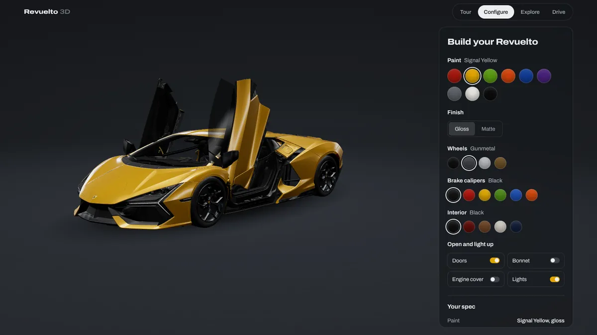
      <h3>Configure</h3>
      <p>Choose from 9 paints in gloss or matte, 4 wheel finishes, 6 caliper colours and 5 interiors. Open the doors, bonnet and engine cover, or switch on the lights. <b>Copy spec link</b> gives you a URL that opens the same build.</p>
    </td>
  </tr>
  <tr>
    <td width="50%" valign="top">
      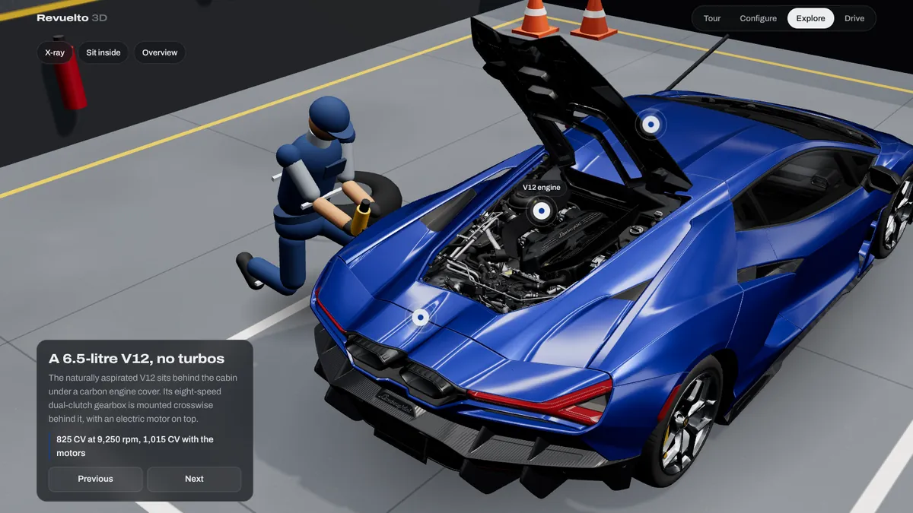
      <h3>Explore</h3>
      <p>Seven glowing points on the car open info cards, and the camera flies to each part. There's also <b>Sit inside</b> for a driver's-eye view and <b>X-ray</b>, which turns the body into a glass shell.</p>
    </td>
    <td width="50%" valign="top">
      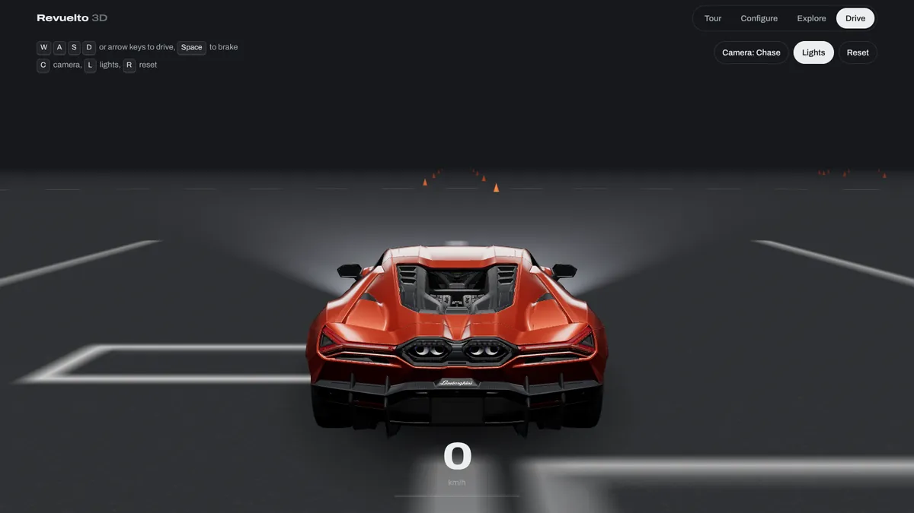
      <h3>Drive</h3>
      <p>Arcade handling on an open lot with a cone slalom and a skid pad. You get three cameras, working headlight beams and a speedometer. Phones show on-screen pedals and steering buttons.</p>
    </td>
  </tr>
</table>

### The garage

<p align="center">
  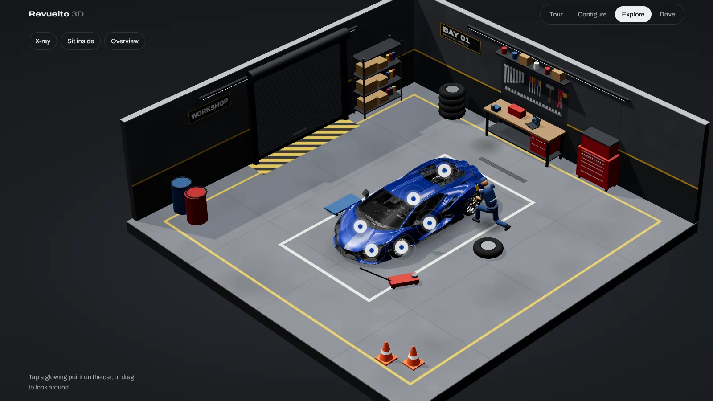
</p>

Configure and Explore open in a cut-away workshop seen from a high isometric angle. The walls rise into place as you arrive. Orbit around and whichever walls face you drop away, so the car is never hidden.

Behind the car a **mechanic** works through a loop. He kneels at the left-rear wheel with an impact wrench, stands, walks to the red tool cabinet, pulls a drawer open to look for a tool, and walks back to carry on. The room has a workbench with a pegboard of tools, shelving, a tyre stack, a roller door with daylight coming through, a compressor and a trolley jack. All of it is built in code, so no extra models are downloaded.

<details>
<summary><b>More screenshots</b></summary>
<br>

| X-ray | Driver's seat |
| :---: | :---: |
| 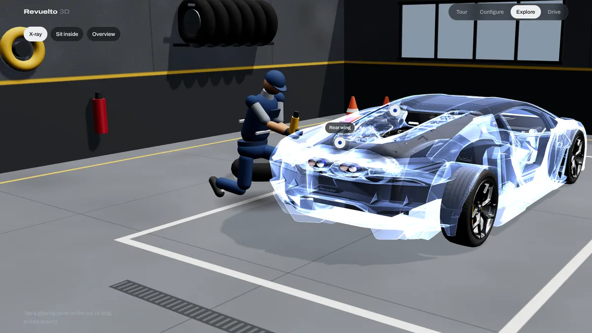 | 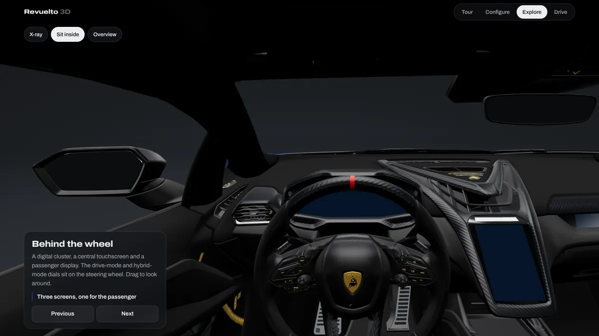 |
| **Tour: the engine chapter** | **Tour: the numbers** |
| 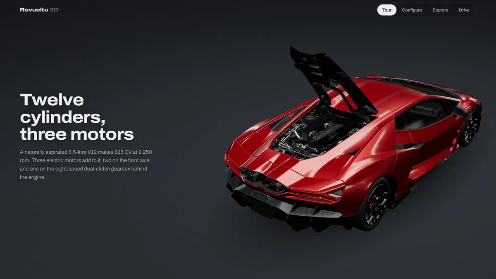 | 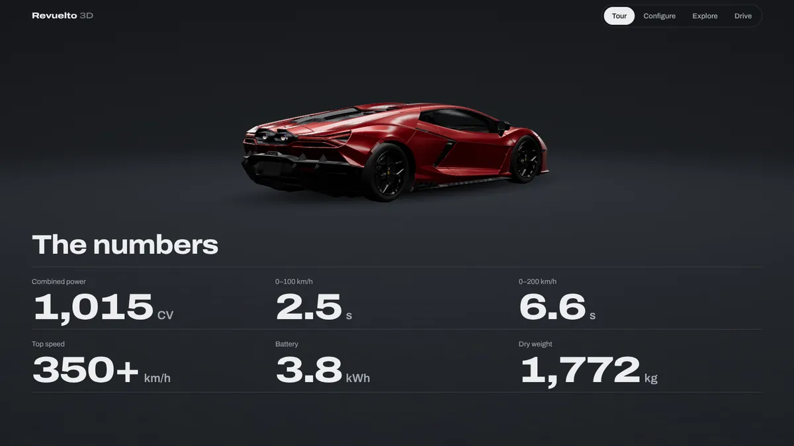 |

</details>

### Built for phones too

<p align="center">
  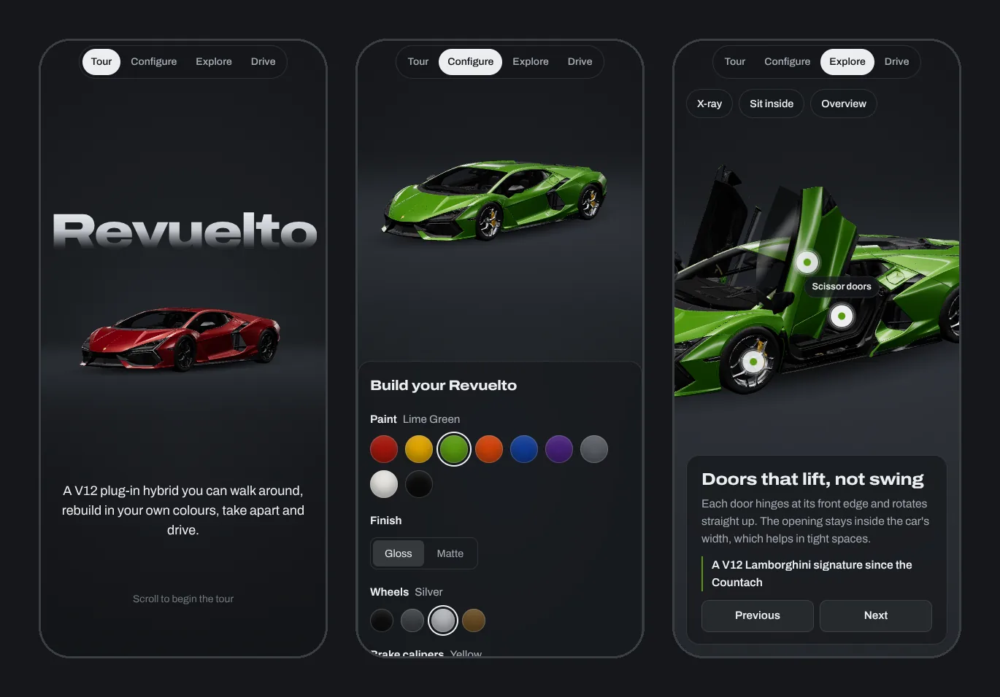
</p>

On narrow screens the text moves below the car, the configurator becomes a bottom sheet, and the camera pulls back so the whole car fits a tall screen.

<br>

## Controls

| | Mouse / touch | Keyboard |
| --- | --- | --- |
| **Tour** | Scroll | <kbd>Space</kbd> <kbd>Page Down</kbd> |
| **Configure, Explore** | Drag to orbit, scroll or pinch to zoom | <kbd>Tab</kbd> to the options, arrow keys inside a colour row |
| **Drive** | On-screen ◀ ▶ **Brake** **Go** | <kbd>W</kbd> <kbd>A</kbd> <kbd>S</kbd> <kbd>D</kbd> or arrow keys, <kbd>Space</kbd> brake<br><kbd>C</kbd> camera (chase, far, cockpit), <kbd>L</kbd> lights, <kbd>R</kbd> reset |

The site respects **reduced motion**: if your system asks for less motion, camera flights become instant cuts and parts snap open.

<br>

## Run it locally

There's nothing to install and no build step. It's plain HTML, CSS and ES modules, but it does need a local server because browsers block module imports from `file://`.

```bash
git clone https://github.com/miteshumretiya/revuelto-3d.git
cd revuelto-3d
npx serve .            # or: python3 -m http.server 8080
```

Then open the address it prints.

### Deploy

This repo is connected to Vercel, so **every push to `main` redeploys** [revuelto-3d.vercel.app](https://revuelto-3d.vercel.app). To deploy your own copy:

[](https://vercel.com/new/clone?repository-url=https://github.com/miteshumretiya/revuelto-3d)

`vercel.json` sets caching (the model is cached for a day; three.js and fonts for 30 days). `.vercelignore` keeps `docs/` and `tools/` out of the deployment.

<br>

## How it works

### Project layout

```
revuelto-3d/
├── index.html              page structure: tour chapters, panels, HUD
├── css/style.css           all styling, desktop and mobile
├── js/main.js              scene, materials, camera, and all four views
├── js/garage.js            the isometric workshop: floor, walls, props, lighting
├── js/mechanic.js          the mechanic: figure, poses and work routine
├── models/revuelto.glb     the optimised car (5.3 MB)
├── vendor/three/           three.js r169 + GLTFLoader, OrbitControls, meshopt decoder
├── fonts/                  Archivo variable font, self-hosted
├── tools/                  offline model-optimisation script (not deployed)
├── docs/screens/           README images (not deployed)
└── vercel.json             cache headers
```

### From 46 MB to 5.3 MB

The source model was too heavy for the web, mostly because every mesh carried six UV sets and two colour channels it never used. `tools/optimize-model.mjs` slims it down without removing any visible geometry:

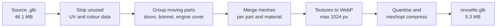

| | Before | After |
| --- | ---: | ---: |
| File size | 46.1 MB | **5.3 MB** |
| Separate meshes | 504 | **115** |
| Draw calls | 560 | **143** |
| Triangles | 548k | 517k |
| Textures | 29 PNG | 28 WebP |

To re-run it on a new export:

```bash
cd tools && npm install
node optimize-model.mjs "path/to/Lamborghini Revuelto.glb" ../models/revuelto.glb
```

Pass a third argument such as `0.6` to also simplify the meshes for a lighter mobile build.

### Inside the scene

- **Rendering:** three.js with ACES tone mapping. Reflections come from a studio of soft-boxes and light strips built in code and baked into an environment map, so no HDR file is downloaded.
- **Hero title:** the word *Revuelto* is HTML that sits *behind* a transparent canvas, so the car sits in front of it.
- **Moving parts:** each door, the bonnet and the engine cover is re-parented under a pivot at its real hinge, then eased open. Wheels get an extra spin node between the steering control and the wheel.
- **Materials:** paint, rims, calipers, leather and stitching are shared materials, so one colour change updates every part that uses it. Glass swaps the costly transmission effect for tinted transparency.
- **Garage:** built from boxes, cylinders and canvas-drawn textures (floor markings, pegboard, signs), then merged into one mesh per material to keep draw calls low. The isometric look comes from a long lens (14° field of view) placed far away. Each wall hides itself when the camera is on its outer side. A daylight key light casts shadows, and the shadow map is only redrawn when a door or panel moves.
- **Mechanic:** a jointed figure (hips, knees, shoulders, elbows, neck) driven by blended poses: kneeling, standing and reaching. A procedural walk cycle ties leg swing to the distance actually covered, so his feet don't slide.
- **X-ray:** body panels switch to an additive Fresnel shader, while the engine, cabin and wheels keep their normal materials.
- **Tour camera:** follows a Catmull-Rom curve through eight keyframes. It eases between chapters and rests while you read.
- **Drive:** a simple bicycle model for steering, where the maximum steering angle shrinks as speed rises. The chase camera widens its lens as you go faster.

<br>

## Make it your own

Almost everything is a plain array near the top of `js/main.js`.

| To change | Edit |
| --- | --- |
| Paint colours, finishes | `PAINTS`, `FINISHES` |
| Wheel, caliper and interior options | `RIMS`, `CALIPERS`, `INTERIORS` |
| Default build | `DEFAULT_SPEC` |
| Tour camera shots and what opens in each chapter | `TOUR` |
| Tour text | the `<section class="chapter">` blocks in `index.html` |
| Hotspots and their info cards | `SPOTS` |
| Isometric camera angle and distance | `ISO` |
| The mechanic's routine (timings, where he walks) | `SEQ` in `js/mechanic.js`, positions in `js/garage.js` |
| Garage props and colours | the wall blocks and `M` materials in `js/garage.js` |
| Driving feel (top speed, acceleration, braking) | `MAX`, `ACC`, `BRAKE` in `stepDrive()` |
| Colours and type of the interface | CSS variables at the top of `css/style.css` |

Add `?snap` to the URL to turn off all easing. That makes it easy to take screenshots or test the views.

<br>

## Credits

- [three.js](https://threejs.org) (MIT) for rendering, glTF loading and orbit controls
- [meshoptimizer](https://github.com/zeux/meshoptimizer) (MIT) for mesh compression, and [glTF Transform](https://gltf-transform.dev) (MIT) for the optimisation pipeline
- [Archivo](https://fonts.google.com/specimen/Archivo) by Omnibus-Type (SIL Open Font License), included in `fonts/`
- Specifications from [Wikipedia](https://en.wikipedia.org/wiki/Lamborghini_Revuelto) and [lamborghini.com](https://lamborghini.com/models/revuelto)

<br>

> [!NOTE]
> **Unofficial fan project.** Not affiliated with or endorsed by Automobili Lamborghini S.p.A. "Lamborghini" and "Revuelto" are trademarks of their owner. The 3D model is supplied by the repository owner and isn't covered by any licence in this repository.
